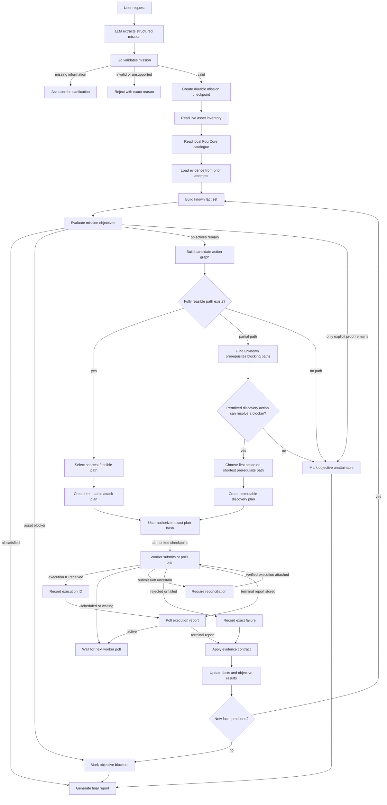

# FourCore ADK Go Agent

A local, single-operator application that translates security-validation requests into catalogue-backed FourCore plans. It uses **Google ADK Go v2.4.0**, an OpenRouter Chat Completions adapter, and the FourCore v2 REST API. A web UI supports conversation, scope review, execution authorization, scheduled starts, progress, evidence, playbook abort, and recovery of uncertain submissions.

## Start on this Windows workspace

Go 1.27.1 has been installed locally under `.tools/go`, without changing your system PATH. The project requires Go 1.26.6 or newer.

```powershell
.\scripts\setup.ps1
# Edit .env as described below, then:
.\scripts\run.ps1
```

Open **http://127.0.0.1:8080** and enter `APP_TOKEN` from `.env` in the application login box. The browser keeps this token in memory only. `scripts/setup.ps1` generates an application token and adds missing settings without replacing existing values. Your existing lowercase `openrouter` environment setting is recognized; `OPENROUTER_API_KEY` takes precedence if supplied.

Only one agent process may use `DATA_DIR` at a time because bbolt holds an exclusive lock on `data/agent.db`. If the configured health endpoint is already available, `scripts/run.ps1` now reports that the agent is running and exits successfully instead of starting a duplicate process.

Required configuration:

| Setting | Value |
|---|---|
| `OPENROUTER_API_KEY` or existing `openrouter` | OpenRouter key |
| `OPENROUTER_MODEL` | Explicit model ID; setup defaults to `deepseek/deepseek-v4.1-flash`, verified in the public model catalogue during implementation |
| `FOURCORE_API_KEY` | Key for your FourCore organization |
| `FOURCORE_BASE_URL` | `https://prod.fourcore.io` for IN-1; `https://prod.me-1.fourcore.io` for ME-1 |
| `APP_TOKEN` | Generated local application credential, at least 24 characters |
| `ALLOWED_ENDPOINT_ASSETS` | Comma-separated endpoint IDs that may appear in execution plans |
| `ALLOWED_EMAIL_ASSETS` | Comma-separated email asset IDs that may appear in execution plans |
| `EXECUTION_ENABLED` | Defaults to `false`; set `true` when ready to submit reviewed plans |

Controlled-lab lateral execution is disabled by default and is separate from FourCore. Enable it only for an isolated lab executor that implements the typed schema and signed-evidence contract:

| Setting | Value |
|---|---|
| `LATERAL_EXECUTOR_ENABLED` | `true` only when the controlled lab executor is ready |
| `LATERAL_EXECUTOR_BASE_URL` | HTTPS base URL for a single source; redirects are rejected |
| `LATERAL_SOURCE_EXECUTORS` | For multi-hop missions, comma-separated `source-asset-id=https://source-executor:port` bindings; one executor runs on each source |
| `LATERAL_EXECUTOR_TOKEN` | Bearer token used only between this service and the lab executor |
| `LATERAL_EVIDENCE_PUBLIC_KEY` | Base64 Ed25519 public key used to verify destination evidence |
| `LATERAL_EVIDENCE_PUBLIC_KEYS` | For multiple destinations, comma-separated `destination-asset-id=base64-public-key` bindings; takes precedence over the single key |
| `LATERAL_ALLOWED_DESTINATIONS` | Comma-separated `asset-id=hostname-or-IP` bindings |
| `LATERAL_CREDENTIAL_REFS` | Comma-separated opaque vault/executor references, never passwords |
| `LATERAL_DEFAULT_CREDENTIAL_REF` | One exact reference listed above; only its SHA-256 hash is persisted |

The repository now contains `cmd/lab-executor` and `cmd/lab-verifier`. The implemented lab action is fixed Windows WinRM/Kerberos on port 5985; SMB, RDP and SSH graph edges are discovery evidence, not runnable lab actions with these binaries. Build and configure the binaries separately on allowlisted Windows lab hosts. The source executor runs under an already provisioned domain identity and maps an opaque reference to that process identity; it never receives a password. The verifier runs on the destination, observes its local Windows token, and signs the exact execution ID, authorized input hash, correlation ID and route. See [lab deployment notes](docs/lab-execution.md). No host deployment or live lateral attempt is performed by the automated tests.

With empty asset allowlists the agent can discover assets and recommend catalogue content, but it cannot persist executable plans. Ask it to list asset IDs, place the selected IDs in `.env`, and restart. Authentication uses one operator credential and one FourCore organization per process. This is not a multi-user or multi-tenant deployment.

Example requests:

* “List our endpoint assets and show their execution eligibility.”
* “Find Windows chains for T1059 and explain what evidence we should expect.”
* “Create a plan for chain `<real ID>` on endpoint `<real ID>`, with cleanup enabled.”
* “Find email simulations for the configured lab mailbox.”
* “Show the last plan's execution and detection results. Distinguish missing evidence.”

* "Why did my last exec fail, and what should I simulate next?"

The model creates proposals. **Authorize and run** binds authorization to the exact stored plan hash. A chat message alone does not authorize a new submission. A scheduled plan starts on or after the selected time while the process is running; overdue queued jobs are processed after restart.

## Implemented scope and known API gaps

| Capability | Support |
|---|---|
| Endpoint inventory, catalogue and chain execution | Implemented |
| Email inventory, catalogue and chain execution | Implemented |
| Playbook catalogue, detail, run, report and abort | Implemented for playbooks whose expanded `uses` values are verified `endpoint`/`email` vectors |
| Firewall catalogue search/details | Implemented for recommendations |
| WAF and Web Gateway execution | Disabled: published schema lacks WAF asset/chain discovery and an unambiguous Web Gateway routing contract |
| One-time scheduling | Implemented through persisted jobs |
| Recurring schedules | Not implemented |
| Typed multi-objective missions | Implemented with ADK graph planning, durable evidence and bounded replanning |
| AD evidence graph and viewer | Implemented for structured domain, group, trust, session, share, ACL, delegation and service evidence |
| Goal-directed lateral route and signed destination proof | Implemented for allowlisted WinRM lab hops with the optional executor/verifier binaries; not yet deployed or live-validated |
| Arbitrary payload/action construction | Not exposed |

Unknown playbook vector labels, unavailable assets, unknown endpoint platforms, insufficient elevation capability, and mismatched target types stop validation. Endpoint availability requires `available`, `connected`, and not `disabled`; email requires `available`, `verified`, and not `disabled`. Cleanup cannot be disabled through this application. `ALLOW_ELEVATED=true` permits plans to request `run_elevated`, and the selected endpoint must advertise that capability. The inventory capability is never treated as proof of the mission's starting user, administrator identity, or successful privilege escalation.

The FourCore API documentation used during implementation had outdated SDK examples. This application uses typed HTTP operations based on the published v2 OpenAPI contract instead of relying on nonexistent SDK functions. Live tenant behavior and permissions still require credentialed integration checks; the automated suite uses local mock servers and does not launch real simulations.

## Architecture

```text
Browser -> authenticated HTTP API -> ADK LlmAgent -> OpenRouter
                                      | tools
                                      v
                            FourCore inventory/catalogue
                                      |
                              validated stored plan
                                      |
                         operator authorization + hash
                                      |
                              durable job worker
                                      |
                     FourCore execution -> evidence + raw step output
```

### Mission workflow

The mission path handles action-oriented requests containing exact asset IDs. A dedicated intake model converts the request into typed requirements; it does not choose catalogue entries, commands, or payloads. Requests such as "test", "simulate", "validate", or "gain access" create a reviewed mission plan immediately instead of asking for another confirmation. Informational questions continue through the normal conversational agent.

The workflow in `internal/app/mission_workflow.go` is an actual routed ADK workflow, not a procedural three-step wrapper. ADK `session.Event.Routes` select every branch and the evidence loop. An invocation ends only at an external gate or a terminal report. The bbolt `Mission` record stores `workflow_stage`, `workflow_version`, and a bounded `workflow_trace`, so the next HTTP request or worker tick resumes the correct graph branch after a process restart.



The graph has three entry paths:

1. `RunMissionRequestGraph` starts with LLM extraction for action-oriented chat requests containing exact asset IDs.
2. `RunMissionGraph` starts with deterministic validation for already structured API or tool input.
3. `AdvanceMissionGraph` loads a durable mission and routes to planning, authorization, submission/polling, reconciliation, evidence application, or final reporting.

The main node responsibilities are:

- `llm_extracts_structured_mission` may structure only the operator's stated objectives and exact asset IDs. It cannot choose catalogue IDs or mark evidence proven.
- `go_validates_mission` normalizes requirement types, expands cross-host objectives into prerequisite predicates, assigns stable requirement IDs, and rejects unsupported predicates.
- `read_live_asset_inventory`, `read_local_fourcore_catalogue`, and `load_evidence_from_prior_attempts` assemble the inputs used by planning. Catalogue search and creation of the reviewable mission plan use the complete persisted snapshot, so a temporary catalogue-detail outage does not discard a valid path. Authorization and submission re-fetch the selected content live and reject a changed or removed entry.
- `build_candidate_action_graph` compiles catalogue entries into `requires`, `produces`, and evidence contracts, removes attempted or disallowed entries, and orders dependencies.
- `select_shortest_feasible_path` uses breadth-first search over predicate states. Every multi-action path enters the staged branch, which creates a plan for only the first permitted action and reevaluates evidence before selecting the next action.
- `create_immutable_attack_plan` and `create_immutable_discovery_plan` persist the exact target scope, cleanup setting, elevation setting, catalogue fingerprints, action contracts, and plan hash.
- `user_authorizes_exact_plan_hash` is an external gate. Authorization writes a durable `authorized` transition; it never occurs from chat text.
- `worker_submits_or_polls_plan` executes one idempotent worker pass. It records `submitting` before the single POST, routes usable execution IDs through `execution_id_received` and `poll_execution_report`, records exact terminal failures, and routes ambiguous submissions to reconciliation.
- `apply_evidence_contract` recursively evaluates reports and nested action steps, stores explicit facts, updates only the objective predicates supported by those facts, and passes structured AD observations to the evidence-graph adapter.
- `new_facts_produced` loops back to objective evaluation. The planner can select an untried follow-up path; it never repeats an uncertain submission.
- `generate_final_report` returns the attack path, execution IDs, objective outcomes, conclusions, workflow stage, and complete stored transition trace.

The persisted mission states are `planning -> awaiting_authorization -> queued -> running/reconcile -> planning`, with terminal `completed`, `unattainable`, or `blocked` states. `workflow_stage` is more precise than status: it names the last ADK node checkpoint, while `workflow_trace` records the node, chosen route, detail, plan ID, and timestamp. Creating a mission never authorizes or submits a simulation.

The planner intentionally has no information-gain, freshness, probability, confidence, or risk formulas. Planning uses hard predicates and stable breadth-first search over fact states. A requirement is proven, disproven, or unknown from explicit report fields. The primary optimization is path length; deterministic tie-breakers prefer fewer unmet prerequisites, non-elevated actions, fewer catalogue actions and stages, fewer techniques, then catalogue ID.

Mission intake only turns MITRE technique IDs explicitly written by the operator into `behavior_executed` requirements. Phrases such as "initial information gathering" do not produce a guessed list of reconnaissance techniques. In an AD lateral-movement mission they produce the `domain_context_observed` prerequisite instead. Requirement IDs are generated by the application, duplicate semantic predicates are merged, and asset IDs are grounded against the exact operator message. When the request says it starts with user, standard-user, low-privilege, or non-elevated permissions, discovery and privilege-escalation actions must run from that context. If the mission explicitly requires elevation, credential and lateral actions wait for structured administrator, SYSTEM, or high-integrity evidence from a completed privilege-escalation report. FourCore's `elevated` inventory field only permits a later `run_elevated` request.

Credential, domain-discovery, privilege-escalation, and lateral-movement effects require both focused catalogue categories and matching metadata. Broad APT, advisory, payload-transfer, kill-chain, and ransomware entries cannot satisfy those semantic predicates merely because they mention a matching tactic. Candidate generation also removes catalogue entries incompatible with the verified endpoint platform before path search. An explicit domain-discovery objective is a prerequisite for credential and lateral stages on the same source, so requested initial information gathering always runs first. For a starting-user cross-host objective with an elevation requirement, the enforced order is focused discovery, focused privilege escalation, credential access, then focused lateral movement. The selected lateral action must identify a protocol; that protocol is persisted onto every matching lateral, reachability, remote-access, and destination-identity predicate before authorization.

Supported requirement types are `behavior_executed`, `domain_context_observed`, `credential_access_validated`, `lateral_movement_validated`, `remote_access_proven`, `identity_observed`, `elevated_context_proven`, `service_reachable`, `detection_observed`, and `behavior_prevented`. Successful credential and lateral simulations prove the modeled behaviors, not usable credentials or a specific remote administrative session. Cross-host proof becomes valid only when a controlled integration supplies matching `source_asset_id`, `destination_asset_id`, `protocol`, reachability, a destination proof token, and destination identity. Those safe fields are retained; credential material is not.

To validate only that a FourCore lateral-catalogue chain executes on a source asset, request a source-only `lateral_movement_validated` mission (`target` is the source asset ID; omit `source` and any destination). Intake does not invent a destination, administrator objective, or AD/credential-discovery prerequisites for this mode. The chain still needs any elevated execution capability declared by its catalogue entry. A completed report with a successful action step satisfies the simulation requirement; it does not establish a remote session.

For a cross-host mission that explicitly starts in user context, intake adds `elevated_context_proven` on the source. This enforces discovery, source privilege escalation, credential validation, and lateral movement in that order. Intake removes a model-produced elevation requirement on the remote destination when remote access to that destination is already an objective. Running an elevation chain directly through the destination's installed FourCore agent would bypass the proposed route and cannot prove lateral administrator access. That outcome remains represented by destination-side `remote_access_proven` and `identity_observed` evidence.

Mission state is exposed through `create_mission`, `get_mission`, `get_mission_report`, `get_mission_graph`, and `plan_mission` agent tools and the `/api/missions` routes below. `plan_mission` accepts a mission ID and an optional typed lateral binding containing destination asset, protocol, opaque configured credential reference, and expected identity; it resumes the graph from its durable checkpoint and never executes. The chat-facing `propose_plan` tool creates standalone FourCore plans and cannot supply mission contracts or requirement links. Mission reports contain the attempted path, execution IDs, requirement outcomes, explicit facts, unknowns, workflow trace, and claims that must not be inferred. The worker calls `AdvanceMissions`; each mission is routed through `AdvanceMissionGraph`, so submission, polling, evidence application, follow-up planning, and reconciliation are graph transitions.

### AD evidence graph

`internal/app/ad_graph.go` converts execution evidence into a durable, mission-scoped graph. It accepts report-level, asset-level, or successful step-level JSON collections named `domains`, `domain_memberships`, `machines`, `computers`, `users`, `identities`, `groups`, `group_memberships`, `trusts`, `sessions`, `shares`, `acls`, `delegations`, `services`, `reachable_services`, `can_smb`, `can_rdp`, `can_winrm`, `can_ssh`, or `protocol_access`. A step's `output` may also contain a valid JSON object. One specifically recognized FourCore discovery chain (`CHAIN_TI067_TERMINALFIX_DISCOVERY_TTPS`) additionally has a bounded parser for its successful system-information, domain-trust, and Domain Admins enumeration output. Arbitrary console prose is not interpreted as an AD fact.

The adapter produces typed edges: `member_of_domain`, `identity_in_domain`, `group_in_domain`, `member_of_group`, `domain_trust`, `session_on`, `hosts_share`, `can_access_share`, `acl`, `admin_to`, `delegation`, `can_smb`, `can_rdp`, `can_winrm`, `can_ssh`, `service_on`, and `service_reachable`. Each observed edge links to provenance containing the execution ID, catalogue ID, step ID, report JSON path, and observation time. Stable IDs make repeated worker passes idempotent. Asset IDs and observed hostnames are merged into one machine when structured evidence establishes the alias. The graph stores relationship metadata only; unrelated passwords, tokens, command lines, and arbitrary output are not copied into it.

`route_planner.go` searches the mission graph using observed or verified edges only. It starts at the requested source asset, filters protocol-specific capabilities, orders candidate paths by machine hops and then relationship count, and accepts a path only if each machine hop has an identity and usable permission/protocol evidence. The selected node and edge IDs are stored in the immutable action input. A separate search over destination-specific `remote_access` edges determines whether access was actually observed; AD relationships or source-only simulations cannot establish that claim. The planner does not crawl the directory or build a tenant-wide BloodHound graph. Unknown prerequisites cause the mission workflow to consider compatible focused discovery before reevaluating the route.

The optional controlled-lab adapter posts only typed fields: correlation ID, source and destination asset IDs, allowlisted destination host, protocol/port, an opaque credential reference, and expected identity. The plan stores the credential-reference hash, never the reference or credential material. A completed claim requires an Ed25519-signed destination record matching the authorized correlation, endpoints, protocol, port, and execution time. Invalid, stale, or mismatched evidence fails terminally. `remote_access_proven` and `identity_observed` are never inferred from submission acceptance or a source-only FourCore simulation.

Open **Plans & runs**, find a mission-linked plan, and select **View AD evidence graph**. The viewer shows discovered machines, identities, domains, groups, services and shares; observed relationships; evidence cards; and the current planned source-to-destination route. The **Conversation history** picker reopens saved chat sessions. A successful source-only lateral chain appears as a purple dashed edge from the source machine to a simulation node, with its execution and step IDs. This records chain execution without inventing a destination. The dashed mint edge is the selected route; destination-verified access is displayed separately. Previously stored terminal reports are backfilled when their mission graph is first opened, so they do not require another simulation.

The implementation is split by responsibility:

- `mission_intake.go`: LLM-to-requirement extraction and grounding against the operator's exact message.
- `mission_workflow.go`: ADK nodes, conditional edges, durable resume routing, graph entry points, and workflow audit transitions.
- `mission.go`: predicate normalization, candidate action construction, shortest-path selection, evidence synchronization, and mission persistence helpers.
- `mission_facts.go`: minimal live inventory reads and explicit asset facts.
- `mission_contracts.go` and `mission_evidence.go`: catalogue action contracts and report-to-predicate evidence rules.
- `ad_graph.go`: structured AD report parsing, graph canonicalization, provenance, durable merging, historical backfill, and selected-route projection.
- `plans.go`: immutable plan validation, hashing, and operator authorization.
- `worker.go`: one-plan submit/poll primitive, recovery, and mission graph advancement.
- `mission_report.go`: objective outcomes, attack path, conclusions, and workflow trace.

`internal/app/agent.go` defines the ADK agent and typed tools. `openrouter.go` implements `model.LLM`, including tool schemas, call/result correlation IDs, bounded responses, a 16,384-token completion allowance, and a 12-model-call budget per turn. It uses non-streaming model requests; the UI waits for the completed turn. The provider must support tools and tool choice. Provider keys, raw asset API keys, process environments, and unrelated host or integration fields never enter model context through inventory/report tools. Raw simulation step output enters model context through the report-analysis tools so the agent can explain what happened.

The `get_execution_report` tool can retrieve a report for a known direct or historical FourCore execution ID. It retains status, aggregate outcomes, per-asset counts, step success/detection flags, limited correlation metadata, and raw step `output`. Agent-facing output is bounded and marks truncation. The plan view stores a larger bounded copy. Use **Complete raw FourCore report** in the UI, or the raw-report application route, to fetch the complete upstream JSON response on demand.

The `get_latest_execution_analysis` tool supports questions such as "why did my last exec fail?" without requiring an execution ID. This intent is resolved before ordinary chat and mission routing. The service selects the most recently observed finished execution attempt from the current chat session; if none exists there, it selects the latest finished attempt in local plan history. If no finished record exists, it can return the latest active or uncertain record using the same session-first order. It refreshes the report from FourCore when an execution ID is available and otherwise uses the stored sanitized report with a warning when refresh fails.

The analysis returns an explicit outcome category such as `submission_failed`, `submission_uncertain`, `terminal_execution_failure`, `partial_execution_failure`, or `execution_completed`. It separates submission and execution state, lists successful and failed nested steps, preserves bounded raw-output excerpts and explicit failure fields, and reports detection and prevention as `observed`, `explicitly_not_observed`, or `unknown_no_explicit_evidence`. For mission-linked runs it also returns all unresolved predicates and an existing follow-up plan ID. Recommendations must use that evidence and verified catalogue entries; the deterministic mission planner decides prerequisite order, and an existing follow-up plan is inspected rather than duplicated.

`fourcore.go` handles authentication, response limits, context cancellation, complete catalogue snapshots, ranked local search, explicit metadata projection and pacing. The complete JSON returned by catalogue list APIs is stored under `DATA_DIR/catalog/`, one file per catalogue kind. Search, agent detail lookups, and reviewed mission-plan creation read these files without calling FourCore. Missing snapshots are populated in the background at startup; use the authenticated refresh route to update them explicitly. Plan authorization and submission validation still fetch the selected entries live to detect changed or removed content. Safe reads retry transport failures, rate limits, and server errors up to three times. Writes are submitted once. The configured request budget is shared by the agent and worker in this process. The default 60 requests/minute leaves headroom under FourCore's documented 100/minute organization-wide limit; other clients share that organization limit. Multiple processes must not share this configuration as if each had an independent organization budget.

`plans.go` expands playbooks, validates scope, fingerprints catalogue content and persists plans. The maximum asset setting bounds target assignments across a plan; a playbook can expand into several chains per target and is additionally bounded by `MAX_PLAN_ITEMS`. Catalogue metadata is re-fetched before authorization and before each submission; changed contents require a fresh plan. Plans expire for authorization after 24 hours. The agent must verify every selected ID with live catalogue details before proposing a plan; rejected or missing IDs are never silently replaced.

`store.go` uses bbolt transactions for durable plans, transcripts and lifecycle audit events. `data/agent.db` is intended for one process; the database file lock prevents concurrent workers in separate processes. Back up the database while the process is stopped. Data is not encrypted by the application: use your operating system's disk protection and restrict access to the data directory. Sessions retain the latest 100 text messages, with the most recent 30 replayed to ADK; tools re-fetch evidence on subsequent turns.

`worker.go` submits plan items in sequence. It saves `submitting` before HTTP dispatch and then persists the returned execution ID. Each item records `submitted_at`, `report_observed_at`, and `completed_at`; these timestamps determine which execution is the latest. A crash or transport ambiguity produces `unknown`, never an automatic second POST. Later items are skipped after failure or uncertain submission. Polling continues independently of the browser. Completed runs remain in `collecting_evidence` for `CORRELATION_WAIT_SECONDS` (default 120) to collect delayed detection correlations, after which the report is a timestamped snapshot. Correlations arriving later require review in FourCore. Unknown platform status strings remain visible as ongoing; terminal status mapping must be checked against a live tenant before relying on unattended scheduling.

Catalogue terminology is enforced in the agent: an `endpoint_chain` is an individual endpoint simulation, while a `playbook` is a curated bundle. Endpoint objectives such as privilege escalation search endpoint chains even when a user informally calls them playbooks. Every plan ID must be retrieved successfully through `get_simulation_details` during the same agent turn before `propose_plan` accepts it. Pre-submission asset reads retry short availability transitions. Report status handling gives explicit failed or aborted states precedence over a generic `FINISHED` detail and uses completed attack counters when FourCore leaves a report in a stale in-progress state.

Recovery: inspect the actual FourCore execution history and use **Attach existing run** for an uncertain item. The application verifies the returned catalogue ID and exact target IDs before attaching it. If the API report cannot establish that match, reconciliation is rejected. The app never retries an unknown submission on your behalf. Deleting an execution is not used as cancellation. Only running playbooks expose the documented abort operation; it is monitored until the platform reports a terminal state.

## Application HTTP API

All `/api/*` routes require `Authorization: Bearer <APP_TOKEN>`. These are application routes, distinct from FourCore's upstream API.

| Method | Route | Body/purpose |
|---|---|---|
| GET | `/healthz` | Process health, no provider call |
| GET | `/api/config` | Non-secret capabilities |
| GET | `/api/catalog/status` | Local snapshot timestamps and entry counts |
| POST | `/api/catalog/refresh` | `{"kind":"all"}` or one catalogue kind; replaces local snapshots from FourCore |
| POST | `/api/chat` | `{"session_id":"", "message":"..."}` |
| GET | `/api/chats` | Saved conversation summaries for the history picker |
| GET | `/api/chats/{id}` | Saved conversation |
| GET | `/api/executions/latest/analysis?session_id={id}` | Latest session-first execution analysis, with stored-history fallback |
| POST | `/api/missions` | Validate a typed mission and run the graph through reviewed-plan creation; never authorizes or executes |
| GET | `/api/missions` | List durable missions |
| GET | `/api/missions/{id}` | Requirements, facts, attempts, status and current plan ID |
| GET | `/api/missions/{id}/report` | Evidence-backed objective results and attack path |
| GET | `/api/missions/{id}/graph` | AD entities, observed evidence edges, provenance, and selected route |
| POST | `/api/missions/{id}/plan` | Create the next reviewed plan; optional body: `{"lateral":{"destination_asset_id":"...","protocol":"smb","credential_reference":"vault://...","expected_identity":"DOMAIN\\user"}}` |
| GET | `/api/plans` | Stored plans and evidence |
| GET | `/api/plans/{id}` | Exact plan, scope and hash |
| GET | `/api/plans/{id}/diagnostics` | Live authorization preflight, typed-input fingerprints, route and executor capabilities |
| GET | `/api/reports/{kind}/{id}/raw` | Complete upstream report; `kind` is `execution` or `playbook` |
| POST | `/api/plans/{id}/authorize` | `{"hash":"...", "scheduled_at":"2026-09-15T10:00:00Z"}`; schedule optional |
| POST | `/api/plans/{id}/cancel` | Cancel an unstarted plan |
| POST | `/api/plans/{id}/abort` | `{"item_index":0}`; running playbook only |
| POST | `/api/plans/{id}/reconcile` | `{"item_index":0,"execution_id":"existing-ID"}` |

UI is bound to loopback by default. Use a TLS reverse proxy and appropriate access controls if exposing it remotely. One chat turn runs at a time; simultaneous requests receive 429. Repeated authorization of an already queued or submitted plan is rejected. The UI renders model and API content as text, not executable HTML.

Suggested FourCore permissions: `assets.read`, `chains.read`, `executions.read`, `chain.execute`; email adds `assets.email.read` and `chain.email.execute`; playbooks add `packs.read`, `pack_runs.read`, `pack_runs.execute`, and `pack_runs.abort`. Use the current tenant's API documentation to confirm permissions.

## Build and verification

```powershell
.\.tools\go\bin\go.exe test ./...
.\.tools\go\bin\go.exe vet ./...
.\.tools\go\bin\go.exe build -o fourcore-agent.exe ./cmd/fourcore-agent
node --check internal/app/web/app.js
```

Tests cover the ADK/OpenRouter tool loop, session replay, automatic latest-execution resolution, nested failure and raw-output analysis, ID grounding, secret filtering, platform and target scope validation, email and playbook planning, catalogue drift, schedule timing, authorization, duplicate submission prevention, recovery, graph clarification, all planning checkpoints, exact-hash authorization, submission/poll transitions, uncertain-submission reconciliation, evidence-loop completion, final workflow reports, semantic requirement deduplication, starting-context separation, broad-chain rejection, staged discovery/elevation/credential/lateral ordering, protocol pinning, shortest covering-path selection, protocol-specific graph edges, typed lab requests, signed destination evidence, signature tamper rejection, strict mission evidence predicates, every supported AD relationship, evidence provenance, idempotent graph merging, historical report backfill, graph API output, and the browser graph viewer. Model calls, FourCore operations, and standard lateral-executor operations use local mocked HTTPS servers. Optional browser integration testing uses the installed Python Playwright package:

```powershell
$env:RUN_BROWSER_TEST='1'
.\.tools\go\bin\go.exe test ./internal/app -run TestBrowserUI -v
Remove-Item Env:RUN_BROWSER_TEST
```

An optional live OpenRouter check uses the existing key and **synthetic** `attack.test` and `secattack` asset metadata, and incurs a small model charge. It never uses the real FourCore key:

```powershell
$env:RUN_LIVE_MODEL_TEST='1'
.\.tools\go\bin\go.exe test ./internal/app -run TestLiveOpenRouter -v
Remove-Item Env:RUN_LIVE_MODEL_TEST
```

The standard tests, browser workflow, and a live OpenRouter tool-call check were verified during implementation. The Windows race-detector binary exited before tests with `0xc0000139` in this environment, including a static-link attempt; race verification remains outstanding on a compatible Go/C toolchain.

## References

* [FourCore API documentation](https://prod.fourcore.io/api/docs) and [OpenAPI schema](https://prod.fourcore.io/api/v2/openapi.json)
* [FourCore SDK](https://github.com/FourCoreLabs/attack-sdk-go)
* FourCore API documentation: vectors/assets/chains, playbooks, and API/rate-limit sections
* [Google ADK Go](https://github.com/google/adk-go)
* [OpenRouter API](https://openrouter.ai/docs/api/reference/overview)
